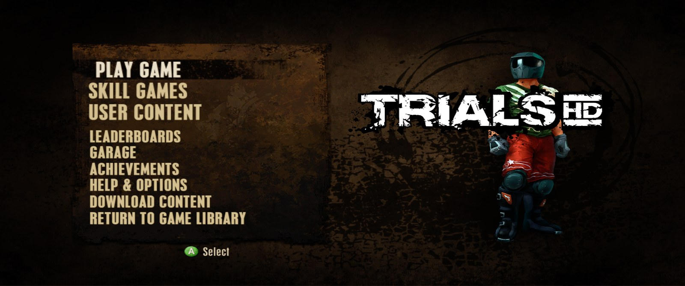
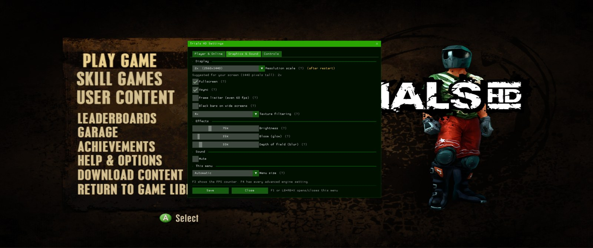
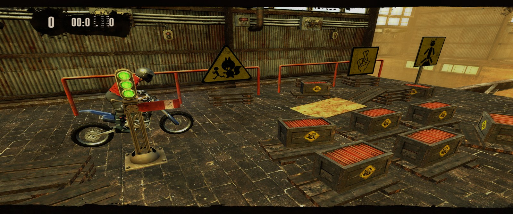

# Trials HD Recomp

A native **Windows and Linux** port of **Trials HD** (Xbox Live Arcade, 2009) made by static
recompilation with [ReXGlue](https://github.com/rexglue/rexglue-sdk). The game's Xbox 360 PowerPC
code is translated to C++ and compiled into a normal program, with Xbox 360 graphics and audio
handled by ReXGlue's runtime (Direct3D 12 on Windows, Vulkan on Linux).

> **No game data is included anywhere in this project.** You need your own legally obtained copy
> of Trials HD.
>
> Not affiliated with or endorsed by Ubisoft, RedLynx or Microsoft.

<p align="center">
  
</p>
<p align="center">
  
</p>
<p align="center">
  
</p>
<p align="center"><sub>Main menu · the F1 settings menu with live Brightness / Bloom / Depth-of-field sliders ·
in game at 3440×1440, 60 FPS on Linux</sub></p>

> **Windows with an NVIDIA card (especially 120 Hz+ screens): if the game stutters or the frame
> pacing feels uneven, press F1 → Graphics & Sound, tick _Frame limiter (even 60 fps)_ and press
> Save.** It applies straight away. More tips are under [Troubleshooting](#troubleshooting).

## Features

- **Native Windows and Linux builds**: no emulator to set up, just extract and run.
- **Full game**, not the Xbox Live Arcade trial.
- **60 FPS** at any resolution on a mid-range PC, with a resolution scale up to 3x (4K).
- **Online leaderboards and friends** on a free community server (`trials.bytrev.org`), or your
  own. See [Online leaderboards](#online-leaderboards).
- **In-game settings menu (F1)** for your name, online, graphics, effects and sound, with no
  config file editing needed.
- **Live picture effect sliders**: turn down the game's strong **bloom**, **depth-of-field blur**
  and **brightness** while you play, and see the change instantly.
- **Controller or keyboard**: any Xbox or PlayStation controller, or play on the keyboard.
- **Optional 60 fps frame limiter** for smooth frame pacing on high-refresh screens and NVIDIA
  cards.
- Quits properly from the game's own Exit option.

## Status

Tested on a Radeon RX 6750 XT (Windows 11 and Ubuntu 26.04), plus reports from RTX 50-series
players and an Intel UHD 620 laptop.

- The whole game plays, with audio, on Windows and Linux.
- There's a short hitch when a track loads, and the first time each effect is seen while its
  shader compiles. After that it's cached.
- Intel integrated graphics (UHD 620 class) are only good for around 15 fps once the 3D track
  preview starts.
- Some players have reported uneven frame pacing on Windows with NVIDIA at 120 Hz+. Try the frame
  limiter (see [Troubleshooting](#troubleshooting)) and let us know in an issue if it helps.

## Download and play

1. Download the [latest release](../../releases/latest): **TrialsHD-windows-….zip** for Windows or
   **TrialsHD-linux-….tar.gz** for Linux, and extract it.
2. Get your game files (`default.xex` and the `data` folder) from your own copy of Trials HD.
   See [Getting your game files](#getting-your-game-files) below.
3. Copy `default.xex` and `data` into the `assets` folder next to `trialshd.exe`.
4. Run `trialshd.exe` (`./trialshd` on Linux).
5. Optional: press **F1** in game to set your name and password and go online.

**Updating:** copy the new `trialshd.exe` (or `trialshd`) and the `.dll`/`.so` files over the old
ones. Keep your `trialshd.toml` and `assets` folder, and your settings and game files stay as they
are.

### Windows

Requirements: 64-bit Windows 10/11, a DirectX 12 graphics card, a CPU with SSE4.2 (2009 or later),
and the [Microsoft Visual C++ Redistributable (x64)](https://aka.ms/vs/17/release/vc_redist.x64.exe)
(install it if Windows says `MSVCP140.dll` or `VCRUNTIME140.dll` is missing).

### Linux

The Linux build is a `.tar.gz` (it keeps the program's executable flag):

```
tar xzf TrialsHD-linux.tar.gz
cd TrialsHD
# copy default.xex and the data folder into assets/
./trialshd
```

Requirements: 64-bit Linux with glibc 2.38 or newer (Ubuntu 24.04+, Fedora 39+, Arch, SteamOS 3.6+,
...), `libcurl4` for online play, and a Vulkan driver (Mesa RADV for AMD, the NVIDIA driver, or
Mesa ANV for Intel). The window uses X11, so on a Wayland desktop XWayland must be available (it is
by default on Ubuntu, Fedora, KDE, ...).

## Settings menu (F1)

Press **F1** (or **LB + RB + X** on a controller, **Q + E + X** on the keyboard) to open the Trials HD
settings menu. Press **Save** to keep changes; they're written to `trialshd.toml` next to the game.
On a controller, **LB / RB** switch tabs and **B** closes the menu.

| Tab | Settings |
|---|---|
| **Player & Online** | Your name, password, play online on/off, server address, **Test connection** |
| **Graphics & Sound** | Resolution scale (1x 720p / 2x 1440p / 3x 4K, with a suggestion for your screen), fullscreen, frame limiter, vsync, black bars on wide screens, texture filtering, mute, menu size |
| **Effects** (on the Graphics tab) | **Brightness** 50–150%, **Bloom (glow)** 0–200%, **Depth of field (blur)** 0–100%. 100% is the original game. They change the picture **instantly**, so open F1 mid-track and tune them where it matters. Press Save to keep them. |
| **Controls** | The full list of controller and keyboard controls |

Other keys: **F3** shows the FPS overlay, **F4** has every advanced engine setting.

Everything in the menu can also be set by hand in `trialshd.toml`. For example:

```toml
trialshd_brightness = 0.85   # 0.5 - 1.5   (the three effects also change live in F1)
trialshd_bloom = 0.5         # 0 = off, 2 = double
trialshd_dof = 0.0           # 0 = always sharp
trialshd_fps_cap = 60        # 0 = off
```

## Controls

Any Xbox or PlayStation controller works as it would on the console. On a keyboard:

| Key | Does |
|---|---|
| ↑ / W | Accelerate (and up in menus) |
| ↓ / S | Brake (and down in menus) |
| ← → / A D | Lean back / forward |
| Enter / Space | Select (A) |
| Backspace | Back (B) |
| Escape / P | Pause (Start) |
| Tab / R | Restart (Back) |
| Q / E | LB / RB |
| X / Y | X / Y |
| Numpad 8 2 4 6 | D-pad |

The keyboard and a controller work at the same time. Turn keyboard play off in the F1 menu
(Controls tab) if you only want the controller.

## Troubleshooting

- **Stutter or uneven frame pacing** (especially at 120 Hz+ or on NVIDIA): turn on **Frame
  limiter** in F1 → Graphics & Sound. On NVIDIA you can also set *Low Latency Mode: Off* and
  *Vertical sync: Use the 3D application setting* for `trialshd.exe` in the NVIDIA Control Panel.
- **Too bright, washed out or blurry:** lower **Brightness**, **Bloom** and **Depth of field** in
  F1 → Graphics & Sound → Effects. It changes as you drag; press Save to keep it.
- **Slow on a laptop / integrated graphics:** set Texture filtering to Off, plug the charger in,
  and use the Performance power mode. On Linux with **fractional display scaling** (125%, 150%,
  ...), the game draws at the scaled-up size, so 150% means 2.25x the pixels. Set the display scale
  to 100% for the best speed.
- **Linux, earlier builds (v0.3.0 and before):** every crash or quit left the game's memory
  behind in `/dev/shm`, slowly using up RAM until the game crashed or showed a black screen. Newer
  builds clean this up themselves. To clear what old builds left, run
  `rm /dev/shm/xenia_memory_*` or reboot.
- **Online not working:** use F1 → Player & Online → **Test connection**. The name must be 1–15
  letters, digits, spaces, `_` or `-`, and the password 8 or more characters.
- **Crashes:** `crash.txt` and the newest file in the `logs` folder show what happened. Please
  attach them, zipped, to an issue. For more detail, set `log_level = "info"` in
  `trialshd.toml`, but set it back to `"warn"` afterwards because it slows the game down.

Saves and the shader cache are stored in your user folder (on Linux `~/.local/share/trialshd`),
not next to the program.

## Getting your game files

This project doesn't include or link to the game. You need **your own copy of Trials HD**, the
Xbox Live Arcade game bought on an Xbox 360 (title ID `5841095A`). The port always runs as the
full game, so please only use it with a copy you've paid for, not the free trial.

### 1. Copy the game package off your Xbox 360

Xbox Live Arcade games are stored as one package file (an STFS "LIVE" file) on the console.

1. On the Xbox 360, go to **Settings → System → Storage**, select a USB drive and choose
   **Configure Now** to set it up as an Xbox storage device. Then copy **Trials HD** to it under
   **Games and Apps**.
2. Plug the USB drive into your PC. Windows can't read the Xbox format directly, so open it with an
   Xbox 360 storage tool such as **Velocity** or **Horizon**.
3. Browse to `Content/0000000000000000/5841095A/000D0000/` and copy out the file inside. It has a
   long hexadecimal name and no extension; that's the game package.

If your console has a hard drive that you can connect to the PC, the same tools can read it and the
package is in the same folder.

### 2. Extract the files

**Easiest:** open the package file in **Velocity** or **Horizon** (the same tools as above), which
show its contents, and extract everything to a folder.

Disc-image tools such as extract-xiso won't work: Trials HD is a download, stored as an STFS
package rather than a disc image (ISO).

**Or with the included script:** you need [Python 3](https://www.python.org/downloads/) (no extra
packages). Download this repository (**Code → Download ZIP**), open a terminal in its folder and run:

```
python tools/stfs_extract.py "<path to the package file>" extracted
```

This checks every block of the package and writes the contents to the `extracted` folder. Either
way you end up with:

```
extracted/
  default.xex      <- the game executable
  data/            <- all the game data
  ArcadeInfo.xml   (not needed)
```

Copy `default.xex` and `data` into the `assets` folder next to `trialshd.exe`.

## Online leaderboards

Xbox Live is gone, so the game's leaderboards, friends lists and "post your time" talk to a small
community server instead: **`trials.bytrev.org`**. The game uploads your time when you finish a
track, and the in-game leaderboards (global, friends, around you) show everyone on that server,
ranked like Xbox Live: fewest faults, then fastest time.

**To go online**, press **F1** in game, enter a name and a password on the *Player & Online* tab,
tick *Play online*, press **Test connection**, then **Save** and restart. Or fill in the same
values by hand in `trialshd.toml` next to the game. The server address is already filled in:

```toml
trialshd_player_name = "YourName"                    # 1-15 letters, digits, spaces, _ or -
trialshd_server_url = "https://trials.bytrev.org"    # already set: the community server
trialshd_player_key = "make-up-a-password"           # 8+ characters, pick your own
```

- The first time your name connects, the server remembers your password; after that only that
  password can post times as you. Pick a password you don't use anywhere else.
- Names are first come, first served.
- Friends need no setup: everyone on the server shows up on your "Friends" leaderboard.
- With the name or password left empty, the game stays offline.

**Running your own server instead** (for a private group): the easiest way is the free Cloudflare
Workers version, set up entirely in the Cloudflare dashboard: see
[`server/worker/README.md`](server/worker/README.md). To host it at home instead, see
[`server/README.md`](server/README.md) (a single Python file, Docker/Unraid). Then put your
server's address in `trialshd_server_url`.

## Building it yourself (no local tools needed)

GitHub Actions can build the exe for you in a **private** copy of this repository (the build needs
your game's `default.xex`).

1. Create a **private** repository from this one: use **Use this template → Create a new
   repository** and set it to *Private* (a fork of a public repository is always public, so don't fork).
2. Get `default.xex` as described in [Getting your game files](#getting-your-game-files).
3. In your private copy, add the executable and push:
   ```
   git add -f private/default.xex
   git commit -m "Add my default.xex"
   git push
   ```
4. Open **Actions → Build Trials HD** and wait for the run to finish (about 30–40 minutes).
   Download the **TrialsHD-windows** or **TrialsHD-linux** artifact, then follow steps 3–4 above.

In this public repository the workflow has no game files and just reports that there is nothing
to build.

## What's in here

| Path | Purpose |
|---|---|
| `rexglue/trialshd_manifest.toml` | ReXGlue project definition |
| `rexglue/trialshd_config.toml` | Fixes for this game: function entries the analysis missed, setjmp/longjmp, codegen speed options |
| `rexglue/trialshd.toml` | Runtime settings shipped next to the exe |
| `rexglue/src/` | App code: game-file discovery, full-game licence, crash reports, FPS counter, sampling profiler, timer resolution |
| `rexglue/src/online.cpp`, `http_client.*` | Online leaderboards: replaces the game's Xbox Live stats/friends calls with requests to your server |
| `rexglue/src/trials_menu.*` | The F1 settings menu (ImGui), controller shortcut, writes `trialshd.toml` |
| `rexglue/src/keyboard_input.*` | Keyboard controls (an extra input driver that acts as controller 1) |
| `rexglue/src/post_effects.cpp` | Bloom / depth-of-field / brightness: edits the game's post-process shader text as it's loaded |
| `rexglue/src/game_exit.cpp` | Quits cleanly from the in-game Exit option; frees the Linux shared-memory file |
| `rexglue/src/perf_tools.*` | FPS counter, frame limiter, sampling profiler |
| `server/` | The leaderboard server (Python, SQLite), Dockerfile and setup guide |
| `server/worker/` | The same server for Cloudflare Workers + D1 (free tier), with a migration script |
| `.github/workflows/build.yml` | Windows and Linux builds: SDK download, `rexglue codegen`, compile, package |
| `tools/` | STFS extractor, XEX unpacker, and the scanners used to find function entries |

## Notes for developers

Things this game needed beyond ReXGlue's automatic analysis:

- **setjmp/longjmp** (MSVC CRT, used by libpng) must be redirected to native implementations,
  otherwise `longjmp` returns into the wrong frame.
- **Function pointers built in code** (`lis`/`addi` pairs) and stored in data tables point at
  functions the analysis never sees; `tools/find_data_code_ptrs.py` and
  `tools/find_code_built_ptrs.py` find them for the config.
- **`non_argument_as_local` breaks this game:** the stack probe and exception funclets receive
  values in `r12`. The other `*_as_local` options are safe and are what made it full speed.
- **Windows timer resolution:** without `timeBeginPeriod(1)` the game's short sleeps round up to
  15.6 ms and it runs at ~30 FPS.
- **Host occlusion queries** stall the CPU on every query; they're disabled in `trialshd.toml`.
- **Linux signals:** the runtime uses SIGSEGV for GPU memory write-watches during normal play, so
  a crash handler must chain to it rather than replace it.
- **Bloom / DoF / brightness (live):** the game ships HLSL source in `data_misc.pak` and compiles
  it at load time. The three linked copies of zlib's `inflate` are wrapped, and the decompressed
  post-process shaders are rewritten in place (comments stripped to make room, same total length).
  They get a new `float4 trialsFx` parameter, defaulting to the original look. Every frame the game
  calls its effect `SetValue("dofParameters", …)` through an indirect call. That call's entry in the
  recompiled dispatch table is redirected so `trialsFx` is set right after, from the slider values.
- **Keyboard driver order:** the 0.9 SDK's InputSystem stops at the first driver that answers
  capabilities/keystroke queries, and its "nop" driver always answers, so an added driver must be
  moved to the front of the list.
- **Linux shared memory:** the runtime backs guest memory with `/dev/shm/xenia_memory_*` and
  only unlinks it on a clean shutdown. The name is unlinked right after setup (the mapping stays
  valid), so crashes and fast exits don't leak RAM.
- **Leaderboards:** the game's XDK wrappers for `XSessionWriteStats`, `XUserReadStats`,
  `XUserCreateStatsEnumeratorByRank/ByXuid` and `XFriendsCreateEnumerator` are replaced in
  `online.cpp`. Trials HD writes the time to property `0x10000002`, faults to `0x10000003` and ranks
  by `0x20000006` = -(faults << 32 | time); leaderboard column 1 is the time, column 3 the faults.
  Reads with an XOVERLAPPED complete from a worker thread, so the menus never wait on the network.

## Credits and licence

- [ReXGlue SDK](https://github.com/rexglue/rexglue-sdk) (BSD-3-Clause), built on
  [Xenia](https://github.com/xenia-project/xenia) (BSD-3-Clause). See `NOTICE.md`.
- Trials HD is © RedLynx / Ubisoft, published on Xbox 360 by Microsoft. This project is not
  affiliated with or endorsed by them.
- The code in this repository is released under the MIT licence (`LICENSE`).
